# JobHunt-AI: Advanced AI Evaluation & Automated Quality Engineering Platform

[](https://github.com/Shashank101-aiml/JobHunt-AI/actions/workflows/ci.yml)
[](https://github.com/Shashank101-aiml/JobHunt-AI)
[](https://github.com/Shashank101-aiml/JobHunt-AI)
[-indigo.svg)](https://github.com/Shashank101-aiml/JobHunt-AI)
[](https://github.com/Shashank101-aiml/JobHunt-AI)
[](https://www.python.org/)
[](https://nodejs.org/)
[](LICENSE)

JobHunt-AI is an evidence-based, agentic job search, resume tailoring, and ATS optimization platform. It features an automated quality engineering and evaluation framework combining **DeepEval-based LLM output evaluation**, **Playwright browser end-to-end testing**, **Pytest + Requests backend API automation**, and a **multi-stage GitHub Actions CI/CD pipeline**.

---

## 1. System Architecture & Component Interactions

```mermaid
flowchart TD
    subgraph UI ["Frontend Studio (React + Vite + TypeScript)"]
        UI_Resumes["Resume Manager"]
        UI_Jobs["Job Discovery (Manual & Scrape)"]
        UI_Match["ATS Match Evaluator"]
        UI_Tailor["Tailoring Studio (Dual-Column Editor)"]
        UI_Review["Human Review & Submission Checklist"]
        UI_Tracker["Application Lifecycle Tracker"]
    end

    subgraph API ["FastAPI Backend (REST API /api/v1)"]
        Routes_Core["/health, /dashboard/stats"]
        Routes_Resume["/resumes (Upload, List, Active, Delete)"]
        Routes_Jobs["/jobs (Manual, Scrape, Search)"]
        Routes_Apply["/apply, /status, /match/evaluate"]
        Routes_Apps["/applications, /review, /submit, /events, /download-docx"]
    end

    subgraph CoreEngine ["Services & Orchestration Layer"]
        ResumeParser["Resume Parser (PDF, DOCX, TXT)"]
        JDParser["JD Parser & Normalizer (Taxonomy Matching)"]
        ScraperRegistry["Scraper Registry (Greenhouse, Lever, Direct URL)"]
        ATSScorer["ATS Evidence Scorer (5-Factor Formula)"]
        LangGraphOrch["LangGraph State Orchestrator"]
        TailorEngine["Tailoring Engine (LLM Context Ingestion + Heuristic Fallback)"]
        DocxExport["DOCX Document Generator"]
        SubAdapters["Submission Adapters (Manual Confirmation & SMTP)"]
    end

    subgraph Storage ["Persistence & Retrieval Layer"]
        DB[("PostgreSQL / SQLite Database")]
        ChromaStore[("ChromaDB Vector Store\n(all-MiniLM-L6-v2 ONNX Embeddings - 384d)")]
    end

    subgraph QualityGate ["Test Automation & Evaluation Framework"]
        E2E["Playwright E2E Automation (17 Tests)"]
        APITests["Pytest + Requests API Automation (53 Tests)"]
        UnitTests["Pytest Unit & Integration Tests (35 Tests)"]
        DeepEvalEngine["DeepEval LLM Evaluation (18 Scenarios)"]
    end

    UI --> API
    API --> CoreEngine
    CoreEngine --> Storage
    QualityGate -.-> UI
    QualityGate -.-> API
    QualityGate -.-> CoreEngine
```



---

## 2. Verified Implemented Capabilities

The capabilities below represent **actual source code implementations** in the repository:

| Capability | Module Path | Implementation Details |
| :--- | :--- | :--- |
| **Multi-Format Resume Ingestion** | `app/services/resume_parser.py` | Extracts text from PDF (`pypdf`), DOCX (`python-docx`), and TXT. Extracts contact info (Email, Phone, LinkedIn, GitHub), parses skills via taxonomy, extracts work experience and education, and rejects 0-byte or corrupted files. |
| **Local ONNX Vector Store** | `app/vector_store/chroma_client.py` | Generates 384-dimensional dense vectors using local ONNX `all-MiniLM-L6-v2` embeddings with zero external API calls. Indexes and queries top-k resume experience chunks. |
| **Job Description Parsing** | `app/utils/jd_parser.py` | Normalizes raw job text, extracting job title, company, work type (remote/hybrid/onsite), minimum years of experience, salary ranges, and taxonomy-grounded skill requirements. |
| **Scraper Subsystem with Domain Guardrails** | `app/services/job_scrapers/` | Scrapes Greenhouse (`boards-api.greenhouse.io`), Lever (`api.lever.co`), and direct public URLs. Enforces botwall boundaries: requests to `linkedin.com`, `indeed.com`, or login-walled sites raise `RestrictedJobSourceError` (HTTP 403) guiding users to manual input. |
| **Transparent 5-Factor ATS Scoring** | `app/utils/ats_scorer.py` | Implements weighted evidence formula: **Required Skills: 40%**, **Preferred Skills: 15%**, **Experience YoE: 20%**, **Keyword Density: 15%**, **Section Completeness: 10%**. Emits subscore breakdowns, demonstrated matches, and gap recommendations. |
| **Grounded Resume Tailoring & Fallback** | `app/services/tailor_service.py` | Injects ChromaDB candidate evidence chunks into LLM prompt (Anthropic Claude or OpenAI). If no API key is supplied, automatically executes deterministic **offline heuristic alignment** highlighting verified skills without failing. |
| **Personalized Cover Letter Generator** | `app/services/cover_letter_service.py` | Generates tailored narrative cover letters grounded strictly in verified candidate achievements. |
| **LangGraph Pipeline Orchestration** | `app/orchestrator/graph.py` | Orchestrates multi-step application pipeline: JD normalization $\rightarrow$ resume retrieval $\rightarrow$ ATS scoring $\rightarrow$ tailoring $\rightarrow$ cover letter generation, transitioning to status `ready_for_review`. |
| **Human-in-the-Loop Review** | `app/services/submission/` | Requires explicit candidate review and verification checklist (contact info, factual truth, eligibility) before transitioning applications to `submitted`. |
| **DOCX Document Export** | `app/services/tailor_service.py` | Generates formatted Microsoft Word (`.docx`) tailored resume files with OpenXML MIME headers. |
| **Database Persistence** | `app/database.py` | Async SQLAlchemy models with Alembic migrations. Connects to PostgreSQL or defaults to zero-config local SQLite (`jobhunt.db`). |

---

## 3. Test Automation & Quality Engineering Architecture

```mermaid
flowchart TD
    subgraph Level4 ["Layer 4: DeepEval LLM Output Evaluation (18 Scenarios)"]
        Eval_Faith["FaithfulnessMetric (Context Grounding)"]
        Eval_Halluc["HallucinationMetric (Fabrication Detection)"]
        Eval_GEval["G-Eval Custom Metric (JD Alignment)"]
        Eval_Det["DeterministicSourceValidator (YoE Inflation, Bogus Skills, Injections)"]
        Eval_Schema["Pydantic JSON & Schema Validation"]
    end

    subgraph Level3 ["Layer 3: Playwright Browser End-to-End Automation (17 Tests)"]
        E2E_Resumes["Workflow 1: Resume Uploads (TXT, DOCX, PDF, JPG Rejection, Empty File)"]
        E2E_Jobs["Workflow 2: Manual Ingestion, Length Threshold, Restricted Scraper Alert"]
        E2E_Match["Workflow 3: ATS Score Ring, Subscores Breakdown, Recommendations"]
        E2E_Tailor["Workflow 4: Dual-Column Tailoring Generation & Input Validation"]
        E2E_Review["Workflow 5: 3-Item Human Checklist & Manual Edit Persistence"]
        E2E_Download["Workflow 6: Binary DOCX Download Intercept & File Integrity"]
        E2E_Resilience["Workflow 7: Network Disconnection, 500 Server Error, 404 Route Boundary"]
    end

    subgraph Level2 ["Layer 2: Pytest + Requests Backend API Automation (53 Tests)"]
        API_Core["Core & Health: /health, /dashboard/stats, CORS, Latency < 0.5s"]
        API_Resumes["Resumes: Upload, List, Active, Activate, Delete, Format Rejection"]
        API_Jobs["Jobs: Manual Creation, URL Deduplication, Scrape Guardrails, Pagination"]
        API_ATS["ATS Matching: Subscore Weighting, Role Discrimination Separation"]
        API_Apps["Applications: Sync Pipeline, Review Updates, Status Transitions, Events, DOCX"]
        API_Security["Security & Resilience: SQL Injection, XSS Tags, Unicode/Emojis, 405/422"]
    end

    subgraph Level1 ["Layer 1: Unit & Component Tests (35 Tests)"]
        Unit_Parser["Parsers (PDF, DOCX, TXT regex & entity extraction)"]
        Unit_Scraper["Scraper unit handlers & URL normalization"]
        Unit_ATS["ATS scorer unit math & taxonomy checks"]
        Unit_Embed["Vector store ONNX dimensionality & ChromaDB queries"]
        Unit_Pipeline["LangGraph state graph transitions"]
    end

    Level4 --> Level3
    Level3 --> Level2
    Level2 --> Level1
```



---

## 4. Test Suites Inventory & Verified Metrics

| Test Layer | Test Location | Test Count | Pass Rate | Execution Time | Report Artifact |
| :--- | :--- | :---: | :---: | :---: | :--- |
| **Unit & Integration** | `tests/test_*.py` | **35** | **100% (35/35)** | ~10.2s | Terminal / Coverage |
| **DeepEval LLM Evaluation** | `tests/eval/` | **18** | **100% (18/18)** | ~7.5s | [`docs/reports/deepeval_evaluation_report.md`](docs/reports/deepeval_evaluation_report.md) |
| **Backend API Automation** | `tests/api/` | **53** | **100% (53/53)** | ~13.2s | [`docs/reports/api_test_report.html`](docs/reports/api_test_report.html) |
| **Playwright Browser E2E** | `frontend/e2e/specs/` | **17** | **100% (17/17)** | ~132s | [`docs/reports/playwright_e2e_report.md`](docs/reports/playwright_e2e_report.md) |
| **Total Test Automation** | **Full Repository Test Suite** | **123** | **100% (123/123)** | **~2.7m** | Comprehensive Multi-Layer Reports |

---

## 5. Test Execution Instructions

### A. Run Unit & Integration Tests (Layer 1)
```bash
# Run 35 unit/integration tests with coverage
pytest tests/test_*.py -v --cov=app --cov-report=term-missing
```

### B. Run DeepEval LLM Evaluation Pipeline (Layer 4)
```bash
# Run standalone evaluation runner (18 synthetic scenarios with score validation)
python tests/eval/run_evaluation.py

# Run evaluation tests via Pytest
pytest tests/eval/ -v
```

### C. Run Pytest + Requests Backend API Tests (Layer 2)
The API test suite executes against a live running FastAPI backend server:

```bash
# Terminal 1: Start FastAPI Backend
uvicorn app.main:app --host 127.0.0.1 --port 8000

# Terminal 2: Run all 53 API tests with self-contained HTML reporting
pytest tests/api/ -v --html=docs/reports/api_test_report.html --self-contained-html
```

### D. Run Playwright Browser E2E Tests (Layer 3)
The Playwright suite executes against the real React frontend and FastAPI backend:

```bash
# Terminal 1: Start FastAPI Backend
uvicorn app.main:app --host 127.0.0.1 --port 8000

# Terminal 2: Run Playwright Tests (Headless Mode)
cd frontend
npx playwright test

# Or run with interactive visual UI:
npx playwright test --ui
```

### E. Run Full Unified Pytest Suite (Unit + Eval + API: 106 Tests)
```bash
# With FastAPI backend running on port 8000:
pytest -v --cov=app --cov-report=term-missing
```

---

## 6. CI/CD Pipeline & GitHub Actions (Phase 4)

Continuous integration is orchestrated via [`.github/workflows/ci.yml`](.github/workflows/ci.yml). The pipeline enforces fast-feedback gating:

```
               ┌──────────────┐
               │  unit-tests  │ (Fails fast on logic regression in ~10s)
               └──────┬───────┘
         ┌────────────┼────────────┬─────────────┐
         ▼            ▼            ▼             ▼
    ┌─────────┐  ┌─────────┐  ┌──────────┐  ┌──────────────┐
    │api-tests│  │e2e-tests│  │ llm-eval │  │ docker-build │
    └─────────┘  └─────────┘  └──────────┘  └──────────────┘
```

1. **`unit-tests`**: Runs 35 unit tests, generates `coverage.xml`.
2. **`api-tests`**: Starts test server, runs 53 API tests, uploads `api_test_report.html`.
3. **`e2e-tests`**: Sets up Node 20, builds frontend, installs Playwright Chromium, executes 17 E2E workflows, uploads test reports and failure traces.
4. **`llm-eval`**: Evaluates synthetic dataset scenarios, enforcing Faithfulness ($\ge 0.85$), Hallucination ($\ge 0.85$), and Alignment ($\ge 0.75$) thresholds. Uses offline mode by default to prevent API costs.
5. **`docker-build`**: Builds container image via [`Dockerfile`](Dockerfile) and Buildx caching.

---

## 7. Verified REST API Endpoint Reference

All endpoints are mounted under `/api/v1` (with `/health` at root):

### Core & Health
- `GET /health` — Returns status of Database, ChromaDB, and configured LLM provider.
- `GET /api/v1/dashboard/stats` — Returns real-time aggregate statistics (total jobs, applications, status counts).

### Resumes (`/api/v1/resumes`)
- `POST /api/v1/resumes` — Uploads and parses PDF, DOCX, or TXT resume with NLP entity extraction.
- `GET /api/v1/resumes` — Lists all uploaded candidate resumes.
- `GET /api/v1/resumes/active` — Retrieves the currently active resume.
- `GET /api/v1/resumes/{id}` — Retrieves resume details by ID.
- `POST /api/v1/resumes/{id}/activate` — Sets target resume as active.
- `DELETE /api/v1/resumes/{id}` — Deletes resume record and clears corresponding vector embeddings.

### Jobs (`/api/v1/jobs`)
- `POST /api/v1/jobs/manual` — Ingests and normalizes raw job posting text.
- `POST /api/v1/jobs/scrape` — Scrapes job postings from permitted URLs (Greenhouse, Lever, public boards).
- `GET /api/v1/jobs` — Lists ingested jobs with pagination (`skip`, `limit`) and keyword/location search.
- `GET /api/v1/jobs/{id}` — Retrieves full structured job posting details.

### Applications & ATS (`/api/v1`)
- `POST /api/v1/match/evaluate` — Computes 5-factor ATS compatibility score and gap analysis.
- `POST /api/v1/apply` — Triggers end-to-end tailoring pipeline synchronously or asynchronously.
- `GET /api/v1/status/{app_id}` — Lightweight status polling endpoint.
- `GET /api/v1/applications` — Lists candidate applications with lifecycle status filters.
- `GET /api/v1/applications/{app_id}` — Retrieves tailored package, before/after score diff, and cover letter.
- `PATCH /api/v1/applications/{app_id}` — Updates application status or notes with audit logging.
- `POST /api/v1/applications/{app_id}/review` — Saves candidate manual edits to tailored resume and cover letter.
- `POST /api/v1/applications/{app_id}/submit` — Executes verified submission with candidate confirmation.
- `GET /api/v1/applications/{app_id}/events` — Retrieves chronological activity audit trail.
- `GET /api/v1/applications/{app_id}/download-docx` — Streams formatted tailored resume as a `.docx` file.

---

## 8. Local Setup & Quickstart

### Prerequisites
- Python 3.10+ (Tested up to Python 3.14.2)
- Node.js 18+ (Tested on Node 20)
- Git

### 1. Clone & Set Up Backend
```bash
git clone https://github.com/Shashank101-aiml/JobHunt-AI.git
cd JobHunt-AI

# Create virtual environment
python -m venv venv
# Windows:
.\venv\Scripts\Activate.ps1
# Linux / macOS:
source venv/bin/activate

# Install test & runtime dependencies
pip install -r requirements-test.txt

# Configure environment
copy .env.example .env
```

### 2. Start Backend Server
```bash
python -m uvicorn app.main:app --host 127.0.0.1 --port 8000 --reload
```
Swagger UI will be available at [http://127.0.0.1:8000/docs](http://127.0.0.1:8000/docs).

### 3. Start Frontend Studio
In a separate terminal:
```bash
cd frontend
npm install --legacy-peer-deps
npm run dev
```
Open browser at [http://localhost:5173](http://localhost:5173).

---

## 9. Container Deployment (Docker & Compose)

```bash
# Build production container image:
docker build -t jobhunt-ai:latest .

# Run complete stack via Docker Compose (PostgreSQL, Redis, App, Celery):
docker-compose up -d
```

---

## 10. Operational Honesty & Ethical Boundaries

1. **No Phantom Submissions**: An application is never marked `submitted` merely because an API was called. Portal applications remain in `requires_manual_action` until candidate confirms.
2. **Zero Factual Hallucination**: Prompts and heuristic fallbacks instruct the engine strictly to ground content in authentic candidate achievements retrieved from ChromaDB.
3. **No Terms of Service Violations**: Restricted job boards (e.g. LinkedIn, Indeed) are blocked from automated scraping, with clean guidance directing users to manual input.
4. **Offline Resilience**: Full core functionality (parsing, vector embedding generation, ATS scoring, heuristic tailoring, and testing) operates with zero external paid API dependencies.
